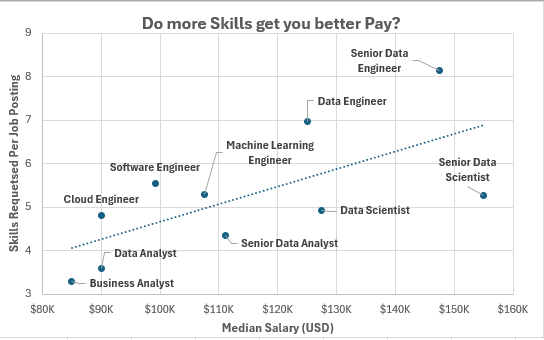
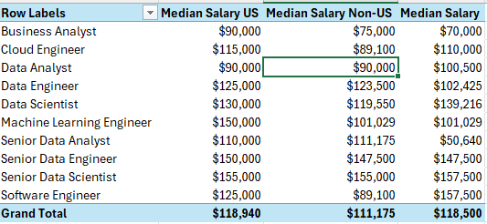
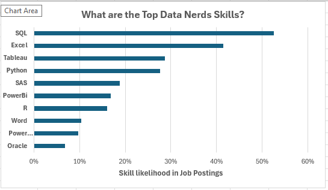
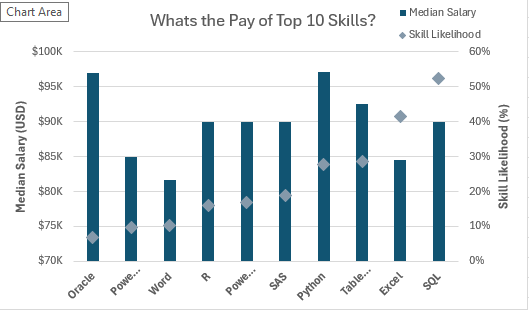

# Excel_Salary_Skills_Analysis
## Project Overview

This data jobs salary and skills analysis was created to help job seekers and career switchers understand how skills influence compensation across data-related roles. The workbook investigates whether acquiring more skills leads to higher salaries, benchmarks median salaries across US and non-US markets, and identifies both the most in-demand and the highest-paying skills in the data job market.

The workbook uses Power Query for cleaning, an Excel Data Model to relate tables, and custom measures such as job count, skill count, and skill per job (skill count/job count) to drive the analysis.

The data is from Luke Barousse's Excel Data Analytics course and contains real-world data science job postings from 2023. 

### Workbook File
My final workbook is in [Salary Analysis](workbook/salary_analysis.xlsx)

### Excel Skills Used

The following Excel skills were utilized for analysis:

- **🔄 Power Query**
- **🗂️ Data Model & Relationships**
- **🧮 Formulas and Functions**
- **📉 Charts**
- **🎛️ Slicers**

### Data Jobs Dataset

The dataset used for this project contains real-world data science job posting information from 2023. It is available via Luke Barousse's Excel Data Analytics course and includes detailed information on:

- **👨‍💼 Job titles**
- **💰 Salaries**
- **🌍 Locations**
- **🛠️ Skills**

## Workbook Build

### 🔄 Power Query & Data Model

- 🛠️ **Excel Features:** Used Power Query to clean and transform the raw job posting data before loading it into the workbook.
- 🗂️ **Data Modeling:** Built an Excel Data Model and created relationships between the jobs table and the skills table.
- 🧮 **Custom Measures:** Created unique formulas against the Data Model for **job count**, **skill count**, and **skill per job** (skill count/job count).
- 💡 **Insights Gained:** A relational model made it possible to analyze salary and skills together without duplicating or flattening the data.

### 📉 Charts & Analysis Sheets

The workbook contains four analysis sheets, each answering a specific question about the data job market.

#### 💰 Salary vs. Skills per Job - Scatter Chart



- 🛠️ **Excel Features:** Utilized a scatter chart plotting median salary against skill per job for each job title.
- 🎨 **Design Choice:** Scatter plot chosen to reveal the relationship (or lack of one) between the number of skills and salary.
- 📊 **Data Representation:** Each point represents a job title, positioned by its median salary and its average skills per job.
- 💡 **Insights Gained:** This answers whether more skills means increased salary, and shows that the relationship is not strictly linear; some high-skill roles pay less than lower-skill roles.

#### 🌍 Median Salary US vs. Non-US - Comparison Table with Slicer



- 🛠️ **Excel Features:** Built a comparison table of median salary for data jobs across US, Non-US, and any selected country.
- 🎛️ **Slicer Integration:** A country slicer sits beside the table for interactive filtering.
- 📊 **Data Representation:** Side-by-side columns for US and Non-US median salaries, with an overall median for the selected country.
- 💡 **Insights Gained:** Enables quick comparison of how the same job title pays in the US versus other markets, and how any chosen country stacks up.

#### 🏆 Top 10 Skills for Data Nerds - Horizontal Bar Chart



- 🛠️ **Excel Features:** Utilized a horizontal bar chart to rank the top 10 skills by likelihood of appearing in job postings.
- 🎨 **Design Choice:** Horizontal bars for easy visual ranking of the top ten skills.
- 🎛️ **Slicer Integration:** Job title and country slicers sit beside the chart for interactive filtering.
- 💡 **Insights Gained:** SQL, Excel, and Python emerge as the most in-demand skills across data roles.

#### 💵 Top Paying Skills - Combo Chart



- 🛠️ **Excel Features:** Utilized a combo chart combining a median salary series with a skill likelihood series.
- 🎨 **Design Choice:** Median salary is plotted on the left axis, while skill likelihood (skill per job, expressed as a percentage) is plotted on the right axis.
- 🎛️ **Slicer Integration:** Two slicers — country and job title — sit beside the chart for interactive filtering.
- 💡 **Insights Gained:** Highlights which top-ten skills command the highest median salaries while also showing how frequently each skill is requested.

### 🧮 Formulas and Functions

#### 📊 Skill per Job

```
= Skill Count / Job Count
```

- 🔍 **Custom Measure:** A unique formula built on the Excel Data Model that divides the total skill count by the total job count.
- 📊 **Data Model Powered:** Calculated against related tables, so it responds dynamically to slicer and filter selections.
- 🎯 **Tailored Insights:** Provides the average number of skills requested per job title.
- **🔢 Formula Purpose:** This measure powers the x-axis of the scatter chart and the skill likelihood series in the combo chart.


#### 🗂️ Skill Likelihood

```
= Skill Per Job (expressed as a percentage)
```

- 🔍 **Percentage Conversion:** The same skill-per-job measure is expressed as a percentage to represent the likelihood of a skill appearing in a job posting.
- 📊 **Combo Chart Driver:** Feeds the secondary axis of the top-paying-skills combo chart.
- 🎯 **Tailored Insights:** Makes skill demand directly comparable to salary on a single visual.
- **🔢 Formula Purpose:** This measure populates the skill likelihood column used in the skill analysis tables.


### 🎛️ Slicers

#### 🔍 Connected Slicers

- 🔒 **Global Filtering:** All slicers in the workbook — country and job title — are connected across sheets, so a single selection filters every chart consistently.
- 🎯 **User Input Control:** Slicers restrict the view to predefined job titles and countries, keeping the analysis focused and consistent.
- 👥 **Usability:** Interactive filtering across all four analysis sheets makes the workbook easy to explore without editing formulas.


## Conclusion

I created this workbook to explore how skills and location shape salary across data-related job titles. Using Power Query for cleaning and an Excel Data Model for relationships, the analysis turns raw 2023 job postings into four connected sheets — salary vs. skills, US vs. non-US pay, top skills, and top-paying skills. Exploring the connected slicers reveals how job title and country influence both the demand for a skill and the salary it commands.
